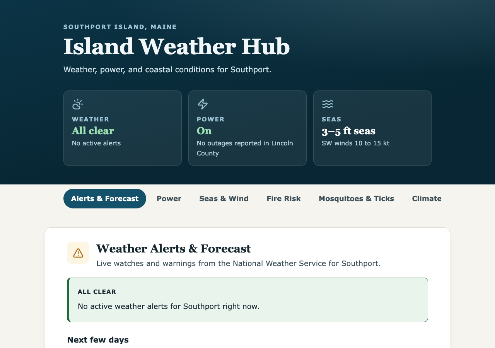
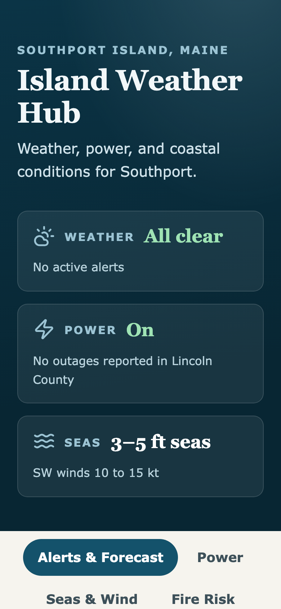

# Town Weather Hub

[](https://github.com/anniebritton/town-weather-hub-template/actions/workflows/tests.yml)
[](LICENSE)

A one-page weather, power, and coast dashboard you can fork and point at your own small town in an afternoon. National weather apps are too coarse for a rural community and miss what matters locally: which utility to call, what a gale warning means for the boats on your moorings, whether the well is going dry. This puts that in one place, in large plain type.



*Screenshots use mocked data, not live weather.*

**Live demo (Southport, Maine example): <https://anniebritton.github.io/town-weather-hub-template/>** (works once GitHub Pages is enabled for the repo, see below).

It is plain HTML/CSS/JS: **no server, no build step, no paid services**. Data comes from free public sources (National Weather Service, NOAA tides, the U.S. Drought Monitor), and the site is hosted free on GitHub Pages.

## Who is this for

- Residents or volunteers in a small town, island, or rural county who want a local page people can bookmark, and who are comfortable editing a JSON file.
- Town offices, fire departments, libraries, and community groups that want something they can keep running without a developer.
- Not a replacement for official emergency channels; see the disclaimer at the bottom.

## What you get

- Live **weather alerts and forecast** from the NWS, with plain-language "what this means for your town" translations you write once
- **Power outage numbers** from your utility's public data, refreshed every 15 minutes by a GitHub Action (optional; link-outs otherwise). The page shows "Unavailable", never a reassuring "On", whenever the numbers are missing, malformed, or out of date
- **Marine conditions**: wind, seas, wave heights, and NOAA tides at your nearest gauge (switch off with one line in `town.json` if you are inland; see [`examples/inland-desert/`](examples/inland-desert/town.json))
- **Daily fire danger** map from your state forestry agency, and a **drought** map with private-well guidance
- **Mosquito and tick activity estimates** computed from the day's forecast
- **Long-term flood and climate risk** resources
- A printable **fridge card** with emergency numbers and checklists that work when the power doesn't
- **Storm Mode**: when the NWS issues a severe warning the page switches to a red alert layout with a preparedness checklist, tide timing, and the utility's phone number (preview any time with `?storm=demo`)



## How it works

All town-specific values (coordinates, NWS office and zones, tide station, utility, local advice text, emergency numbers) live in one file, [`town.json`](town.json); the page reads it at load time and fetches live data straight from the public APIs. The `town.json` in this repo describes a fictional town, "Exampleton, Anystate", with placeholder identifiers. Two complete worked examples are provided: [`examples/southport/`](examples/southport/town.json) (a real coastal town in Maine, which is what the live demo shows) and [`examples/inland-desert/`](examples/inland-desert/town.json) (a fictional inland town with the coastal features switched off).

## Use this template

1. On GitHub, click **Use this template** (top right) and choose **Create a new repository**. (If you are reading a copy that is not a template, clone it and push to a new repo instead.)
2. Edit `town.json` for your town (steps below). Run `npm run check-config` to list what is still a placeholder or marked `TODO`, and `npm run check-config:online` to have NWS and NOAA confirm your zone, grid, radar, marine zone and tide station.
3. Turn on GitHub Pages: **Settings, Pages, Source: GitHub Actions**. The included `pages.yml` publishes your own `town.json` in your repository. (The Southport demo overlay runs only in the upstream template repository, so your site can never show another town's phone numbers.)
4. Optional, for outage data: **Settings, Actions, General**, allow workflows read/write permissions, then add your API key as a repository secret (see "Point the outage data at your utility").

> **Using an AI coding agent?** Point it at [`AGENTS.md`](AGENTS.md). It has a step-by-step "set this up for my town" workflow (looks up your NWS grid and zones, fills in `town.json`, checks the result) and the rules for changing the template itself.

## Adapt it to your town

### 1. Name and place

Edit `site` in `town.json` (compare with [`examples/southport/town.json`](examples/southport/town.json) for what finished values look like): `name`, `place` (used in sentences such as "No active weather alerts for ..."), `kicker`, `tagline`, `description`, and `area_name` (the county or region used in the storm-mode demo alert).

### 2. Point the weather at your town

Get your identifiers from the free, keyless NWS API: open `https://api.weather.gov/points/{lat},{lon}` for your coordinates and copy:

| `town.json` key | What it is | Where to find it |
|---|---|---|
| `location.lat`, `location.lon` | Town coordinates (map centers, forecast link) | Any map |
| `location.timezone` | IANA time zone (the tests run the browser in the root config's zone) | e.g. `America/New_York` |
| `nws.office`, `nws.grid_x`, `nws.grid_y` | Forecast gridpoint | `properties.gridId`, `gridX`, `gridY` |
| `nws.alerts_zone` | Forecast zone for alerts | `properties.forecastZone` (last part, e.g. `XXZ000`) |
| `nws.marine_zone` | Coastal waters zone | [NWS marine zones](https://www.weather.gov/marine/); not needed if `features.marine` is `false` |
| `nws.radar_station` | Nearest radar, e.g. `KXXX` | `properties.radarStation` |
| `tides.station` | NOAA tide station ID | [tidesandcurrents.noaa.gov](https://tidesandcurrents.noaa.gov/); not needed if `features.tides` is `false` |

#### Inland towns (no coast)

Turn off the coastal parts in `town.json`; no HTML editing is needed:

```json
"features": { "marine": false, "tides": false, "climate_coastal": false, "pests": true }
```

This removes the Seas & Wind tab and tile, the tides, the coastal flood map, and the boat and high-tide lines from the storm banner and fridge card. You can then delete `nws.marine_zone`, `nws.marine_description`, the `tides` block and the `seas_*` thresholds. Also replace `alerts.demo_event` (what `?storm=demo` shows) with an alert your area really gets, such as `Red Flag Warning`, and drop coastal entries from `local_meaning`. `npm run check-config` lists any coastal wording still left. See [`examples/inland-desert/town.json`](examples/inland-desert/town.json).

`features.pests: false` removes the Mosquitoes & Ticks tab (useful if the seasonal calendars do not fit your climate).

#### Values you cannot verify yet

Write `TODO` (or `TODO: reason`) instead of guessing. A phone number of `TODO` appears on the page and fridge card as a visible **TODO: add number** and is never a dialable link, and a TODO link is simply not shown. `npm run check-config` lists every TODO. Never invent phone numbers, agencies or shelter locations: a wrong number on an emergency card is worse than a visible gap.

### 3. Point the outage data at your utility

This is the piece that varies most. Many utilities block cross-origin requests from other websites, so `.github/workflows/outages.yml` fetches the utility's public data server-side with `scripts/fetch_outages.py` and commits `data/outages.json` for the page to read (the "git scraping" pattern); it then starts the Pages deploy so the site picks up the new numbers. The schedule is **commented out** in the template: uncomment the `cron` line once your provider and secret are set (until then the workflow exits in seconds).

- **Kubra Storm Center** utilities usually allow direct browser requests (look for `kubra.io/stormcenter/api` in your browser's dev tools on the outage map page). You may be able to skip the workflow and change `loadOutages()` in `app.js` to fetch directly.
- **Avangrid-family utilities** (the response shape `fetch_outages.py` understands): set `outages.provider` to `"avangrid"`, set `api_url`, `api_key_header`, `match_town`, and `match_county`, and add the public subscription key from your utility's outage-map request headers as a repository secret named `OUTAGE_API_KEY` (**Settings, Secrets and variables, Actions**). `town.json` stores only the *name* of the environment variable (`api_key_env`), never the key. If you rename it, update the `env:` line in `outages.yml` to match.
- **Anything else**: set `outages.provider` to `"none"` and rely on the link-out buttons (`report_url`, `map_url`). A reliable button beats a broken widget. The page shows a "data unavailable" message with the buttons if the data file is missing.

`data/outages.json` in this repo is a fictional sample marked `"sample": true`; the page ignores it. With provider `"none"` or no secret, the workflow does nothing and the Power section shows link-outs and "Unavailable" instead of numbers.

How the page treats the data: it is shown only if the file has the expected shape, is not a sample, and was fetched within `outages.stale_after_minutes` (default 90); otherwise the Power tile says "Unavailable". The fetch script rejects a malformed API response and keeps the last good file (the run fails visibly), and rewrites the file only when the numbers change or every ~45 minutes, to keep the commit history small. If your town never matches a row, run `OUTAGE_API_KEY=... python3 scripts/fetch_outages.py --towns` to see how the utility spells town and county names.

### 4. Swap the state-level resources

- **Fire danger**: set `fire.map_url` (and the agency text). Many agencies forbid embedding their map (a blank frame); set `fire.embed` to `false` to show only the "open full-screen" button. Some maps need the iframe offset; see the comment above `.embed-fire` in `styles.css`.
- **Drought**: the [U.S. Drought Monitor](https://droughtmonitor.unl.edu/) publishes a PNG per state; change `current_conus_trd.png` in `drought.image_url` to your state code, e.g. `current_ca_trd.png`.
- **Resource lists**: `resources.flood`, `resources.drought`, and `resources.pests` are lists of `{title, url, description}` links. Replace them with your county, state, and university-extension pages.
- **Pest model**: the scoring in `pests.js` works anywhere, but the seasonal calendars (`mosquitoSeason`, `tickSeason`) are tuned for a northern temperate climate. Adjust the months for your latitude, or delete the Mosquitoes and Ticks tab.

### 5. Localize the words

The highest-value content is also the cheapest to change: the `local_meaning` entries (what each alert type means *here*: which road floods, who to call, where the shelter is), the `fridge_card` phone numbers and write-in lines, and and the checklists in `fridge-card.html` and the storm banner in `index.html` (these two files are plain HTML you may edit; lines about boats and tides are hidden automatically when `features.marine` is `false`). National sites will never have this local knowledge.

`local_meaning` is checked in order and the first matching `pattern` (a case-insensitive regular expression against the NWS event name) wins, so put specific entries before general ones.

### 6. Regenerate the QR code

`assets/site-qr.svg` points at a placeholder URL. Regenerate it for your site, then commit it:

```sh
pip install segno
python3 -c "import segno; segno.make('https://YOUR-SITE-URL/', error='m').save('assets/site-qr.svg', scale=4, dark='#16262e', xmldecl=True)"
```

## Config reference (`town.json`)

| Block | Keys |
|---|---|
| `features` | `marine`, `tides`, `climate_coastal`, `pests` (booleans, all default `true`; `tides` is off whenever `marine` is off) |
| `site` | `name`, `short_name`, `place`, `kicker`, `tagline`, `description`, `app_id` (sent to NOAA as the application name; letters, digits, underscore), `public_url`, `region_name`, `area_name` |
| `location` | `lat`, `lon`, `timezone`, `map_zoom` (Windy map) |
| `nws` | `office`, `grid_x`, `grid_y`, `alerts_zone`, `marine_zone`\*, `marine_description`\*, `radar_station`, `radar_name` |
| `tides`\* | `station`, `name` |
| `outages` | `provider` (`none` or `avangrid`), `utility_name`, `utility_short`, `phone_display`, `phone_dial` (digits only, used for `tel:` links), `report_url`, `map_url`, `api_url`, `api_key_header`, `api_key_env` (env var **name**), `match_town`, `match_county`, `county_label`, `timestamp_zone_label`, `data_file`, `stale_after_minutes` |
| `alerts` | `storm_severities` (NWS severities that trigger Storm Mode), `storm_event_pattern` (regex of event names that also trigger it), `demo_event` (event shown by `?storm=demo`) |
| `thresholds` | `wind_watch_mph`, `wind_caution_mph`, `gust_watch_mph`, `gust_caution_mph`, `seas_watch_ft`\*, `seas_caution_ft`\* (when forecast cards get tinted) |
| `fire` | `agency`, `map_url`, `embed` (`false` hides the iframe), `map_title`, `season`, `burn_note` |
| `drought` | `image_url`, `image_alt`, `region_name`, `well_note` |
| `resources` | `flood`, `drought`, `pests`: lists of `{title, url, description}` |
| `fridge_card` | `title`, `description`, `phones` (list of `{label, number, urgent?}`), `write_ins` (list of labels), `qr_alt` |
| `local_meaning` | ordered list of `{pattern, text}` |

\* only needed when the matching feature is on. Any value you cannot verify can be `TODO`. Every URL must be `https://` (or `TODO`); the page will not link to anything else.

`town.json` is public (it is served by your site), so never put keys or personal contact details in it.

## Architecture notes

- **Plain HTML/CSS/JS, no framework, no build step**, so future maintainers only need a text editor.
- The browser loads `town.json` at start-up; `app.js` fills the page text and builds all NWS, NOAA, Windy, and Climate Central URLs from it. Elements marked `data-town="path.in.config"` in `index.html` get their text from the config.
- All live data is fetched client-side from free public APIs (NWS, NOAA tides) except utility outage data, which the GitHub Action snapshots into the repo.
- Fetch failures degrade gracefully: every live section falls back to a labeled link to the official source. A broken `town.json` shows a visible error naming the problem instead of a blank page, and a bad regex in one `local_meaning` entry never hides a real alert.
- **Safety rules** live in [`town-utils.js`](town-utils.js): remote data is rendered as text or checked numbers (never trusted markup), every link from `town.json` must be `https:`, and identifiers that go into URLs must match their documented shape. Third-party map iframes are sandboxed and send no referrer.
- **Privacy note:** the fonts load from Google Fonts, so visitors' IP addresses reach Google. Delete the three `<link>` lines for fonts in `index.html` and `fridge-card.html` to use system fonts instead.
- An alert zone that NWS does not recognise shows a "Setup problem" card instead of a false green "All clear".
- The pest meters are **weather-based estimates, not surveillance**.

## Tests

None of the tests need internet access or API keys. Node and Playwright are used only for testing.

```sh
npm install
npx playwright install chromium
npm test            # unit + python + browser tests
npm run check-config  # report placeholder values left in town.json
npm run check-config:online  # ask NWS/NOAA whether your zone, grid, radar and stations are real
npm run test:unit   # Node only: text helpers, safety helpers, pest model, town.json validation, outage data contract
npm run test:py     # Python only: scripts/fetch_outages.py parsing (standard library, no installs)
npm run test:e2e    # Playwright against a local static server, with NWS/NOAA/outage data mocked
```

`npm test` runs all three suites even if one fails, then lists which failed.

The unit tests read `town.json`, so they keep passing after you adapt it, and the config test catches typos (bad regexes, malformed zone codes, non-https URLs, a key pasted where an env var name belongs). The config tests and a browser smoke test also cover every `examples/*/town.json`; the inland example is tested to show no coastal content at all. The tests include hostile inputs (script injection through NWS, NOAA and outage data, and `javascript:` links in `town.json`). `.github/workflows/tests.yml` runs everything on pull requests and pushes to `main`.

## Maintenance

- GitHub pauses cron workflows after ~60 days of repo inactivity. The outage bot's commits normally keep it alive; if the Power section says "Unavailable", re-enable the workflow under the Actions tab.
- If the utility rotates its public API key, or changes its response format, the fetch run fails (you will see it in the Actions tab) and the page shows "Unavailable" once the last good data is older than `stale_after_minutes`, rather than presenting old numbers as current. Update the repository secret or `fetch_outages.py`.

## Disclaimer

A site built from this template is a community resource, not an official emergency channel. Always follow guidance from local officials, and call 911 in an emergency.

## Contributing

See [CONTRIBUTING.md](CONTRIBUTING.md) for how to run tests, add an outage provider, or add a local resource section, plus some good first issues. Release notes are in [CHANGELOG.md](CHANGELOG.md).

## License

[MIT](LICENSE), copyright Annie Britton.
